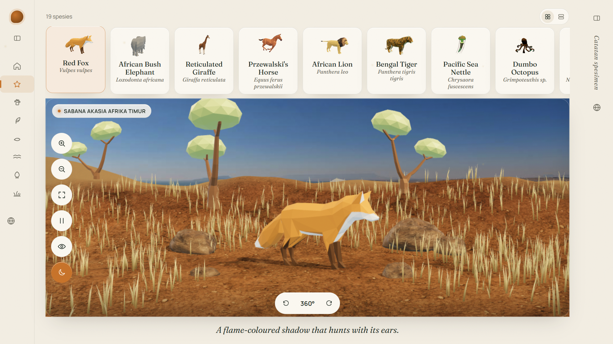
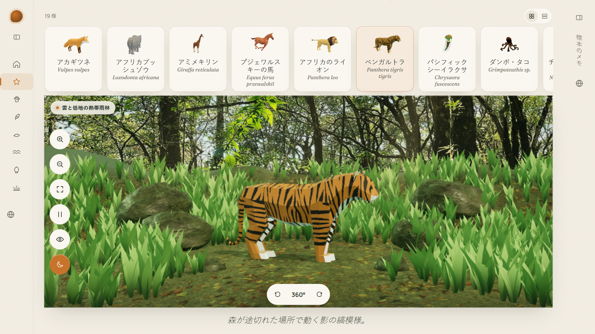

# Zoojelly — Field Atlas: A Living Zoo

An interactive 3D zoo you can explore in the browser. Rotate, zoom, and meet
animals up close — each species lives in a diorama built to match its real
habitat, with locomotion-aware animation, tactile sound cues, and an
encyclopedia-style info panel.

**Live repo:** [github.com/Ikziriv/zoojelly](https://github.com/Ikziriv/zoojelly)
**Created by:** [ikziriv](https://ikziriv.com)

<video src="video.mp4" controls muted></video>

<p align="center">
  
  
</p>

## Features

- **18 species across 7 biomes** — mammals, birds, reptiles, ocean & reef,
  deep sea, and savanna & steppe collections
- **Real-time 3D stage** — orbit, zoom, and cinematic camera moves built on
  React Three Fiber with habitat-matched lighting, sky, and terrain
- **Locomotion-aware actors** — walk, fly, and swim rigs with idle/move
  animation clips, procedural bobbing, and travel paths
- **Habitat dioramas** — HDR environment maps, PBR terrain textures, and
  low-poly environment models per biome
- **Field-guide info panel** — latin names, traits, and close-up notes per
  species, with per-asset attribution shown in-app
- **Synthesized audio** — zero-file Web Audio cues for transitions and UI
- **5 locales** — English, Indonesian, Japanese, Russian, and Chinese via
  i18next with browser language detection

## Tech Stack

| Layer     | Tools                                                        |
| --------- | ------------------------------------------------------------ |
| Framework | React 18 + TypeScript + Vite 6                               |
| 3D        | three.js, @react-three/fiber, @react-three/drei              |
| Motion    | GSAP                                                         |
| State     | Zustand                                                      |
| i18n      | i18next, react-i18next, browser language detection           |

## Getting Started

```bash
npm install
npm run dev        # start the dev server
npm run build      # type-check + production build
npm run preview    # preview the production build
```

### Utility scripts

```bash
npm run test:habitat   # validate habitat configuration
npm run thumbnails     # regenerate species thumbnails
npm run translate      # translate locale files
```

## Project Structure

```
public/
  models/    glTF species + environment models (see CREDITS.txt)
  habitat/   HDRIs, sky backdrops, terrain PBR textures
  thumbs/    species thumbnails
src/
  components/  UI shell — sidebar, species rail, info panel, stage
  data/        species catalogue, localization helpers
  locales/     en / id / ja / ru / zh translations
  three/       scene, actors, habitats, lighting, procedural rigs
```

Every species entry in `src/data/species.ts` carries a `credit` field, so
asset attribution is rendered inside the app's info panel as well as listed
below.

## Credits & Asset Attribution

### 3D models

CC0 (public domain) — attribution appreciated, not required:

- Fox, Horse, Flamingo, Parrot, Stork, Duck — [Quaternius](https://quaternius.com)
- Whale, Manta Ray — Quaternius, Animated Fish Pack
- Fish — see original source package

CC-BY 3.0 (via [poly.pizza](https://poly.pizza)) — attribution required:

| Model     | Title                          | Author          |
| --------- | ------------------------------ | --------------- |
| Elephant  | Elephant                       | elkiotbear      |
| Giraffe   | Giraffe                        | Poly by Google  |
| Chameleon | Spotted Gecko                  | Jeff Larson     |
| Octopus   | Octopus                        | jeremy          |
| Turtle    | Turtle                         | Poly by Google  |
| Jellyfish | Jellyfish                      | Poly by Google  |
| Lion      | Lion                           | Poly by Google  |
| Tiger     | Tiger                          | Poly by Google  |
| Penguin   | Penguin                        | Poly by Google  |
| Crocodile | Crocodile                      | Poly by Google  |

### Habitat dioramas — CC-BY 3.0 (via poly.pizza)

- "Tree from the savanna" — hat
- "underwater_enviro_coral" — God Appeasers
- "kelp" — M Smith Jonn
- "Pond" — Poly by Google

### Environments & terrain — CC0

- HDRIs (`lakeside`, `qwantani_afternoon`, `rainforest_trail`) and terrain
  PBR sets (snow, mud, sand, forest floor, rock) — [Poly Haven](https://polyhaven.com),
  including "Snow 02" by Rob Tuytel

### Fonts

- [Fraunces](https://fonts.google.com/specimen/Fraunces) and
  [Manrope](https://fonts.google.com/specimen/Manrope) — Google Fonts,
  SIL Open Font License

### Audio

- All sound cues are synthesized in-browser with the Web Audio API — no
  external audio files, no attribution needed.

Full machine-readable attribution also lives in
[`public/models/CREDITS.txt`](public/models/CREDITS.txt) and ships with the
build.

## Author

Designed and developed by **ikziriv** — [ikziriv.com](https://ikziriv.com)
(Rizky Ivan Darmawan).

## License

[MIT](LICENSE) © 2026 Rizky Ivan Darmawan.
Third-party assets remain under their original licenses (CC0 / CC-BY 3.0 /
OFL) as credited above.
